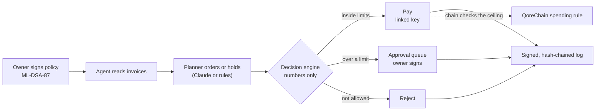
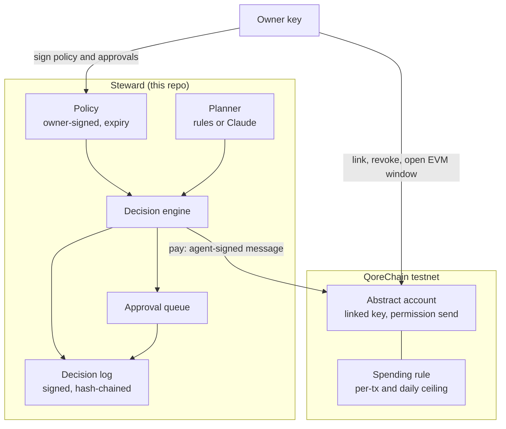

<h1 align="center">Veilbooks Steward</h1>

<p align="center">
  <b>An agent that pays your invoices and can't go over your limits.</b><br>
  The owner signs the limits with a post-quantum key. The agent and the chain both enforce them.
</p>

<p align="center">
  
  
  
  
  
</p>

<p align="center">
  <a href="THREAT_MODEL.md">Threat model</a> ·
  <a href="#live-testnet-run">Live testnet run</a> ·
  <a href="#quick-start">Quick start</a> ·
  <a href="AI_USAGE.md">AI use</a>
</p>

---

## Contents

- [Overview](#overview)
- [The problem](#the-problem)
- [How it works](#how-it-works)
- [Architecture](#architecture)
- [Decision rules](#decision-rules)
- [Features](#features)
- [Live testnet run](#live-testnet-run)
- [Quick start](#quick-start)
- [Browser demo](#browser-demo)
- [Security](#security)
- [Project structure](#project-structure)
- [Configuration](#configuration)
- [Limitations](#limitations)
- [The Veilbooks suite](#the-veilbooks-suite)

## Overview

Veilbooks Steward is an **accounts-payable agent** that pays supplier invoices within limits its owner has signed with a post-quantum key (**ML-DSA-87**). The limits are enforced twice: by the agent's own decision engine, and by a **spending rule on the chain**, so a compromised or misled agent still cannot move more than the owner allowed.

It is built for the QoreChain "Build Before Q-Day" developer fest, in the **PQ AI Agents** track.

## The problem

An AI agent that can pay is only useful if its owner can trust it not to overspend. Agents read free text from suppliers, so a hostile memo can try to talk them into paying more. A limit that lives only inside the agent's own code is a limit the agent can be tricked past.

Steward keeps the limits where the agent cannot change them: signed by the owner, and mirrored by the chain.

## How it works



1. The owner **signs a policy**: limits per invoice, per day and per supplier, the allowed payees and an expiry.
2. The agent reads a batch of invoices. A **planner** may order them or hold some. It can never raise a limit.
3. The **decision engine** looks only at the numbers and the signed policy. It pays, escalates or rejects. A supplier's memo is never read.
4. Escalated invoices wait for the owner, who approves or denies with a **signature bound to that invoice, payee, amount and policy**.
5. Every decision is appended to a **signed, hash-chained log**. Editing or deleting an entry is detected.
6. On chain, the agent's key is linked to the owner's account with a **spending rule** set to the hard ceilings.

## Architecture



| Layer | Enforced by | Covers |
| --- | --- | --- |
| Agent | Decision engine | Per-invoice, daily and per-supplier limits, the allowed payees, duplicates, bad amounts |
| Chain | Spending rule on the owner's account | A hard per-transaction and daily ceiling on the agent's key, whatever the agent does |

## Decision rules

| Condition | Result |
| --- | --- |
| Amount is not a positive whole number | Reject |
| Invoice already paid | Reject |
| Payee not on the allowed list | Reject |
| Above the chain's per-invoice or daily ceiling | Reject |
| Over the agent's per-invoice, daily or per-supplier limit | Escalate to the owner |
| Inside every limit | Pay |

## Features

- **Owner-signed policy** (ML-DSA-87). Any change to the policy invalidates its signature.
- **Two tiers of limits**: what the agent may pay alone, and a higher hard ceiling the chain enforces on the agent's key.
- **Decision engine** that returns pay, escalate or reject from the numbers alone. Free text from suppliers is never read as an instruction.
- **Optional planner**: Claude when `ANTHROPIC_API_KEY` is set, otherwise a deterministic rules planner. A planner can only order or hold invoices.
- **Approval queue** with signatures bound to the invoice, payee, amount and policy.
- **Signed decision log**, hash-chained, signed with the agent's ML-DSA-87 key.
- **Chain link adapter**: builds the owner-signed messages that link the agent's key with its spending rule, and the message that revokes it.
- **Scoped EVM window**: an owner-opened, native-transfer-only window with bounded blocks, transactions and value, and the message that closes it.
- **Browser demo** and an **on-chain script** that links, pays, checks and revokes on the testnet.

## Live testnet run

`scripts/onchain.ts` has run on the QoreChain testnet (`qorechain-diana`). The owner linked the agent's key with the `send` permission and a rule of 20 QOR per transaction and 40 QOR per day.

| Step | Result | Transaction |
| --- | --- | --- |
| Link agent key | linked | `FDF0EA725C854DD55721F6E5D2725B42A33AC792849437176FB5C802969E907D` |
| Agent pays 1 QOR | paid | `6A1275B88D0C5F4267D468B72491B481A642981FCA1548F1F9E95B7588B1CFF2` |
| Agent tries 25 QOR | **refused by the chain**: per-tx limit 20000000uqor exceeded | `FAE3A5DC489DEF2F308D693FF22DC40AC823EF26D826F6E442A187342CE77C27` |

A refused execution still lands as a successful transaction. The refusal is an `abstractaccount_execution_failed` event on it, which the script reads and reports.

```sh
npx tsx scripts/onchain.ts link
npx tsx scripts/onchain.ts pay <qor1 payee> <uqor>
npx tsx scripts/onchain.ts status
npx tsx scripts/onchain.ts revoke
```

The script reads a testnet operator env file from `OPERATOR_ENV` and keeps the agent key in `.agent.json` (git-ignored). It makes real payments but does not run the decision engine first, so what it proves is the chain ceiling.

## Quick start

Requires Node.js 20 or newer.

```sh
npm install
npm test          # policy, decisions, planner, approvals, log, chain link, EVM window
npm run typecheck
npm run dev       # browser demo
```

## Browser demo

`web/` runs the real policy, decision engine, approvals and signed log in your browser. Payments are simulated, so no funds move.

1. Edit the limits and the allowed payees. Keys are generated in the tab.
2. Paste invoices (the sample includes a supplier memo that tries to override the limits).
3. **Sign policy and run agent** to see what was paid, queued or rejected.
4. Approve or deny queued invoices. Each button signs with the owner key.
5. Use **Tamper with an entry** to watch the log check fail.

## Security

[THREAT_MODEL.md](THREAT_MODEL.md) lists each attacker, what stops them, and whether the claim is covered by a test.

| Attack | Result |
| --- | --- |
| Prompt injection in a supplier memo | No effect: memos are never read |
| Hostile or failing planner | Output is sanitised; limits are decided by the engine; falls back to rules |
| Widened or forged policy | Owner signature fails; run refused |
| Approval reused for another amount | Refused |
| Edited, deleted or re-signed log | Detected |
| Payment above the chain ceiling | Refused by the chain (see the live run) |

## Project structure

```
veilbooks-steward/
├── src/
│   ├── policy.ts       policy, owner signature, verification
│   ├── decide.ts       decision engine
│   ├── planner.ts      rules planner and optional Claude planner
│   ├── agent.ts        agent loop, approval queue, signed approvals
│   ├── log.ts          signed, hash-chained decision log
│   └── chain.ts, chainRule.ts   key link, revoke, spending rule, EVM window
├── scripts/onchain.ts  testnet link, pay, status, revoke
├── web/                browser demo (Vite + React)
├── test/               39 tests
├── THREAT_MODEL.md
└── AI_USAGE.md
```

## Configuration

| Variable | Purpose |
| --- | --- |
| `ANTHROPIC_API_KEY` | Optional. Enables the Claude planner. Without it the rules planner is used. |
| `VEILBOOKS_PLANNER=rules` | Force the rules planner (tests set this) |
| `OPERATOR_ENV` | Path to the testnet operator env file for `scripts/onchain.ts` |

Never commit keys. `.env` and `.agent.json` are git-ignored.

## Limitations

- Limits cover **native uqor only**.
- The agent keeps its daily total in memory, which resets on restart. The chain's daily limit is the backstop.
- If the owner's key is stolen, an attacker can sign any policy. Keep it offline.
- The on-chain script does not yet run the decision engine before paying.
- Settling through Veilbooks Rail has not been confirmed for linked keys.
- All keys and funds are for the testnet.

## The Veilbooks suite

| Repository | Role |
| --- | --- |
| [veilbooks-rail](https://github.com/ayushsingh82/veilbooks-rail) | Settlement rollup for private business payments |
| [veilbooks-desk](https://github.com/ayushsingh82/veilbooks-desk) | Sealed invoices and payroll for people and auditors |
| [veilbooks-steward](https://github.com/ayushsingh82/veilbooks-steward) | Agent that pays invoices within limits the owner signed |
| [veilbooks-core](https://github.com/ayushsingh82/veilbooks-core) | Shared library: sealing, commitments, key registration |

## Licence and AI use

Apache-2.0. See [AI_USAGE.md](AI_USAGE.md) for how AI tools were used.
